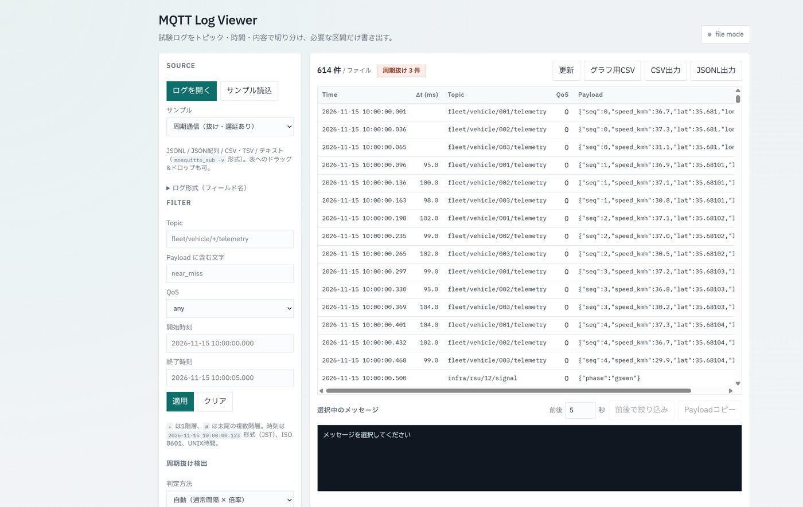
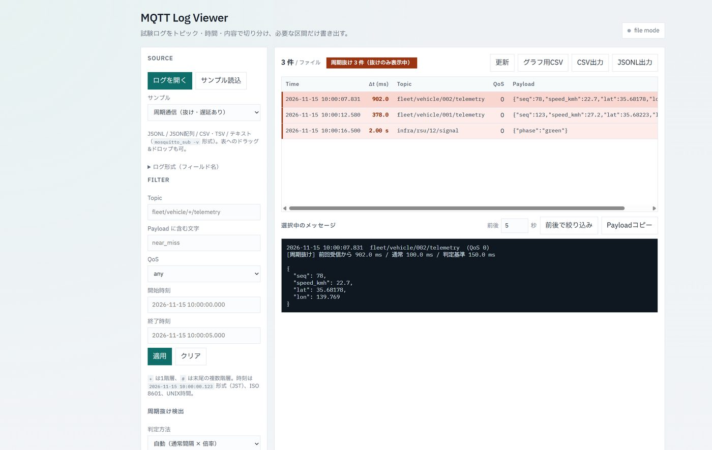

# MQTT Log Viewer

制御・通信試験向けの MQTT ログビューアです。  
ログを開いてトピック・時間・内容で切り分け、周期抜けを洗い出し、必要な区間だけ CSV / JSONL に書き出せます。



## 起動（Windows）

`start.bat` をダブルクリックしてください（中で `start.ps1` を呼び出します）。

1. 初回だけ実行環境の作成とライブラリのインストールを自動で行います（数分かかることがあります）
2. サーバが起動すると、ブラウザが自動で開きます（http://127.0.0.1:8000）
3. 終了するときは、ウィンドウを閉じるか `Ctrl + C` を押します

事前に [Python 3.11+](https://www.python.org/downloads/) が必要です。インストール時は **Add python.exe to PATH** にチェックを入れてください。

すでに 8000 番ポートで起動中の場合は、ブラウザだけを開きます。別のアプリが 8000 番を使っているときは、そのアプリを終了してから再実行してください。

### コマンドで起動する場合

```powershell
python -m venv .venv
.\.venv\Scripts\activate
pip install -r requirements.txt
uvicorn app.main:app --reload --port 8000
```

## 操作デモ（約30秒）

[docs/demo/mqtt-log-viewer-demo.mp4](docs/demo/mqtt-log-viewer-demo.mp4) に、次の流れの操作動画があります（クリック位置が分かるよう、画面上にカーソルを表示しています）。

1. `start.bat` をダブルクリックして起動
2. 周期通信サンプルを開く
3. 「周期抜け ○ 件」を押して絞り込み
4. 前後数秒で切り出して CSV / グラフ用CSV を出力

再生成する場合:

```powershell
# サーバ起動中に
.\.venv\Scripts\python.exe scripts\record_demo.py
.\.venv\Scripts\python.exe scripts\make_demo_video.py
```

## 使い方の流れ

1. **サンプルを開く**  
   左側のサンプルで「周期通信（抜け・遅延あり）」を選び、「サンプル読込」を押します。自分のログなら「ログを開く」か、表へのドラッグ&ドロップでも読み込めます。
2. **周期抜けを確認する**  
   画面上部の「周期抜け ○ 件」を押すと、該当行だけが表示されます。赤い行は、同じトピックの前回受信から判定基準を超えて間が空いたメッセージです。
3. **前後を切り出す**  
   行を選んで「前後で絞り込み」を押すと、その時刻の前後だけに絞り込めます。報告書に貼る区間を作る用途です。
4. **書き出す**  
   - **CSV出力** … ログ一覧（周期抜け判定列 `gap` 付き）
   - **グラフ用CSV** … Payload の数値項目を列に展開（Excel で折れ線グラフ向き）
   - **JSONL出力** … 加工・再読み込み向け



上の画面では、車両 002 の通信断（902 ms）、車両 001 の遅延（378 ms）、路側機の欠落（2.00 s）が検出されています。詳細欄には「通常間隔」と「判定基準」も表示されます。

## できること

- **読み込み**: JSONL / JSON配列 / CSV・TSV（`,` `;` タブ自動判定）/ テキスト（`mosquitto_sub -v` 形式、行頭のタイムスタンプ可）
- **ログ形式の指定**: 時刻・トピック・QoS・Payload のフィールド名（`meta.time` のようなネスト可）。payload 欄が無いログは残りの項目全体を payload として扱う
- **時刻**: ISO 8601 / UNIX時間。`2026-11-15 10:00:00.123` のようにタイムゾーン無しの時刻は JST 扱い
- **絞り込み**: トピック（`+` / `#`）、ペイロード文字列、QoS、時間範囲、選択メッセージの前後N秒
- **Δt**: 同一トピックの直前メッセージからの間隔（元ログ全体基準）
- **周期抜け・遅延の検出**
  - 自動: トピックごとの通常間隔（Δt の中央値、5回以上受信したトピックのみ）× 倍率（既定 1.5）
  - 固定: 全対象トピックに同じしきい値（ms）
  - 対象トピック（`+` / `#` 可）で、event・alert など不定期のトピックを判定から外せる
- **出力**: CSV（Excel 対応 BOM 付き）/ グラフ用 CSV / JSONL
- **その他**: ドラッグ&ドロップ、Payload のコピー、ローカル Broker へのライブ購読（任意）

## サンプルデータ

| ファイル | 内容 |
|---|---|
| `sample_data/sample.jsonl` | 基本サンプル（JSONL） |
| `sample_data/sample.log` | 上と同じ内容のテキスト形式 |
| `sample_data/sample_periodic.log` | 10Hz の車両テレメトリ3台 + 1Hz の路側機。抜け・遅延を仕込んだデモ用 |

周期通信サンプルに仕込んだ異常（`python scripts/make_periodic_sample.py` で再生成）:

- 車両 002: 10:00:07.0〜07.8 の通信断（Δt 902 ms）
- 車両 001: seq 123〜125 が遅延してまとめて到着（Δt 378 ms）
- 路側機: 10:00:15 の信号が1回欠落（Δt 2000 ms）

**実業務のログ・社内トピック設計・機密ペイロードは入れないでください。**

## テスト

```powershell
.\.venv\Scripts\activate
pip install pytest httpx
python -m pytest -q
```

## 想定ユースケース

- 試験後の MQTT ログを、トピック単位ですぐ切り分けたい
- 周期送信のはずのトピックで、通信断や遅延がいつ・何回起きたかを洗い出したい
- 異常イベント前後だけ抜き出して報告書に載せたい
- ローカル検証時に、購読内容をその場で確認したい
